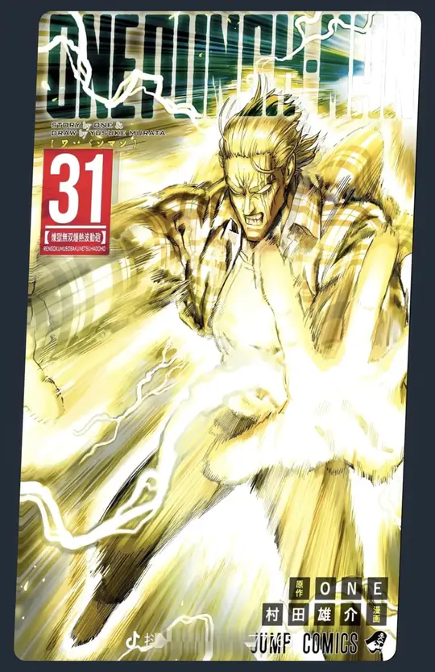
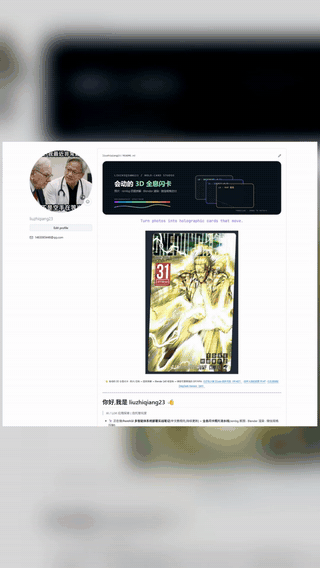

# 你好，我是柳志强 · liuzhiqiang23 👋

**学生开发者 · AI / LLM 应用探索 · 创意工具与自托管实践**

我喜欢把想法做成能运行的作品：从诗人知识问答、电影数据分析，到浏览器游戏和全息闪卡。在实践中学习，也把部署过程与遇到的问题整理成笔记。

**[🌐 中英文作品集](https://liuzhiqiang23-portfolio.gardenbard4.chatgpt.site/) · [English](./README_EN.md) · [知乎](https://www.zhihu.com/people/yi-bu-gen-jiang)**

作品集提供精选项目与演示入口；这里保留公开源码、技术说明和开发记录。

## 精选作品

### 01 · 诗人知识问答与对话系统（Poet-KGQA）

毕业设计：以 57,607 首《全唐诗》为底座，结合知识图谱、语义检索与大语言模型，提供诗人问答、交游图谱探索和诗人对话。技术包括 Python、Neo4j、FAISS 与 DeepSeek。

**[在线体验](https://movie.jszzbinfo.cn/poet/)** · 源码目前不提供公开入口。

### 02 · 光之巨人 · 方块世界

JavaScript / Three.js 3D 体素沙盒生存游戏：白天探索与建造，夜晚守卫神殿、迎战怪兽；贴图、角色与音效由代码程序化生成。建议在电脑浏览器体验。

**[在线试玩](https://liuzhiqiang23.github.io/light-giant/) · [源码](https://github.com/liuzhiqiang23/light-giant)**

### 03 · 全息闪卡的创作实验

围绕 RuiC Card Skill 实践照片分层、Blender 渲染、交互网页和 GIF / MP4 交付。上游作者为 [HRuiCcc](https://github.com/HRuiCcc/RuiC-card-skill)，采用 MIT 许可证；我的工作是工具实践、宿主适配、修复与插件打包。

**[适配仓库](https://github.com/liuzhiqiang23/RuiC-card-skill) · [ZCode 插件市场 PR #21（待审核）](https://github.com/zai-org/zcode-plugins/pull/21) · [上游修复 PR #7](https://github.com/HRuiCcc/RuiC-card-skill/pull/7)**

## 更多项目与实践

| 项目 | 内容与入口 |
| --- | --- |
| 电影数据分析与推荐 | 数据清洗、EDA、票房预测、推荐与 Java / Python 接口联调，延伸到微信小程序实践。[源码与文档](https://github.com/liuzhiqiang23/chuanmeishujuguanlixitong)；仓库沿用早期名称，小程序发布状态以实际审核为准。 |
| 本地大模型与知识问答 | Ollama、LlamaIndex、Flask 与 LangChain 课程实践，涵盖本地模型访问、文档嵌入、检索问答和网页界面。[源码与实践记录](https://github.com/liuzhiqiang23/artificial-intelligent-created-system) |
| 照片到 GIF 表情包 | 探索形象保真编辑、动画、字幕与体积压缩流程。[工具源码](https://github.com/liuzhiqiang23/gif-sticker-maker-free) |
| PentAGI 部署实战笔记 | 第三方多智能体系统的部署和学习记录。[阅读笔记](https://github.com/liuzhiqiang23/pentagi--AI--notes) |
| 小程序开发与部署笔记 | 本地开发、内网穿透、域名、HTTPS、备案流程与踩坑记录。[阅读笔记](https://github.com/liuzhiqiang23/miniprogram-dev-deploy-notes) |

## 常用工具与学习方向

Python · Java / Spring Boot · JavaScript · HTML / CSS · Docker · MySQL · Neo4j · FAISS · Git

正在探索：AI / LLM 应用、RAG、创意交互、HarmonyOS / ArkTS 与自托管工具链。

作品集视频与更多演示

[观看作品集视频](assets/gh-reel.mp4) · [制作过程](https://zhuanlan.zhihu.com/p/2086965296661784206)

GitHub 活动与赞赏

如果笔记与工具帮到了你，可以请我喝杯咖啡。

---

[主作品集](https://liuzhiqiang23-portfolio.gardenbard4.chatgpt.site/) · [早期 GitHub Pages 主页](https://liuzhiqiang23.github.io/) · [知乎](https://www.zhihu.com/people/yi-bu-gen-jiang)
